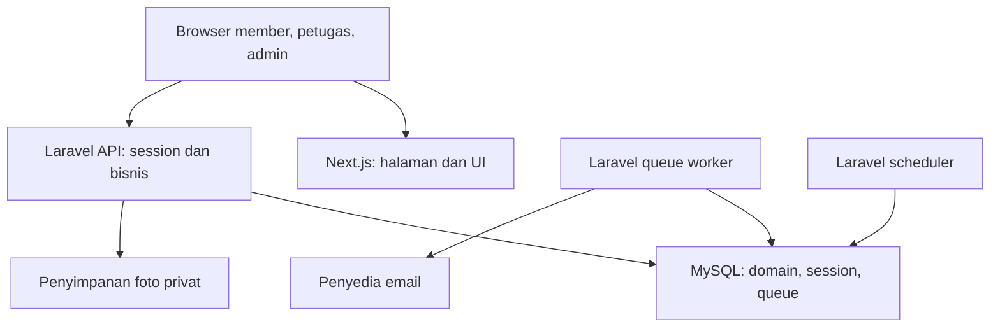
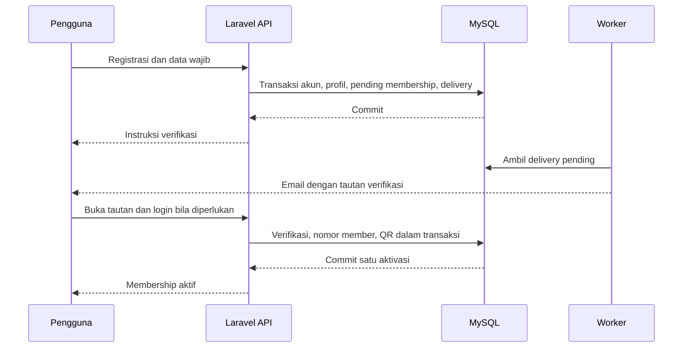
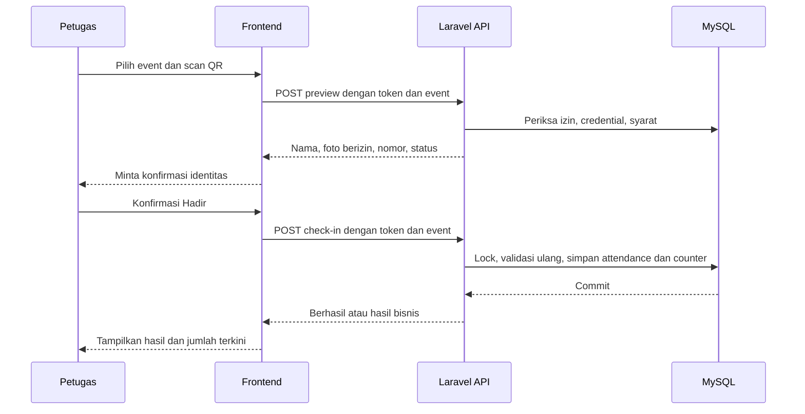
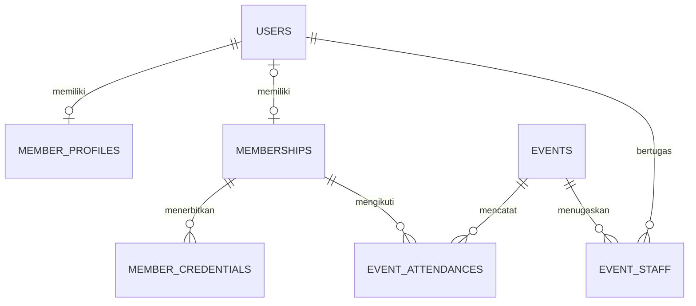

# ARCHITECTURE — sorerunapp

| Atribut | Nilai |
| --- | --- |
| Versi dokumen | 1.0 |
| Tanggal | 14 Oktober 2026 |
| Produk | sorerunapp |
| Komunitas | Sore Running Club (SRC) |
| Acuan bisnis | PRD.md final, termasuk revisi versi teknologi |
| Status | Final — disetujui pemilik produk sebagai acuan implementasi sorerunapp |
| Pola utama | Monorepo; frontend Next.js dan backend Laravel modular |

## 1. Tujuan, sumber, dan kewenangan dokumen

Dokumen ini menerjemahkan PRD final menjadi rancangan sistem, pembagian tanggung jawab, alur proses, model data MySQL, integrasi, dan kebutuhan operasional. Rancangan ini belum merupakan aplikasi yang sudah diimplementasikan atau bukti pengujian kapasitas.

PRD tetap menjadi sumber aturan bisnis. Keputusan terbaru pada PRD Bagian 4.2 dan 19 mengungguli rumusan lama pada bagian lain. Karena itu, arsitektur ini menggunakan event dengan kuota, registrasi tanpa approval, data telepon/domisili wajib, serta reaktivasi membership ended oleh admin.

Ketentuan teknis yang belum disebutkan di PRD merupakan keputusan desain dalam dokumen ini, bukan perubahan ruang lingkup bisnis. Perubahan aturan produk harus memperbarui PRD terlebih dahulu; perubahan implementasi dicatat pada dokumen arsitektur dan kontrak API.

## 2. Ketentuan bisnis yang membentuk arsitektur

| Aturan produk | Implikasi sistem |
| --- | --- |
| Satu komunitas, membership gratis tanpa kedaluwarsa otomatis | Tidak memerlukan tenant, billing, atau renewal pada alur inti |
| Registrasi sekali dan email terverifikasi | Akun, profil, dan membership dipisahkan; aktivasi idempotent |
| Aktivasi otomatis; tidak ada approval admin | Tidak ada antrean peninjauan registrasi |
| Nama, tanggal lahir, telepon, domisili wajib | Backend menjadi validator final; profil wajib lengkap saat aktivasi |
| Anggota di bawah umur diperbolehkan | Tidak ada pembatasan usia minimum otomatis atau akun wali tambahan |
| QR tetap, boleh dicetak/screenshot | Credential dapat dicabut; identitas dikonfirmasi petugas |
| Event gratis, berkuota, tanpa RSVP | Kuota dikonsumsi kehadiran valid saat konfirmasi; tidak ada reservasi |
| Check-in oleh petugas dan harus online | Login, penugasan event, validasi backend, dan respons commit wajib |
| Satu kehadiran per member per event | Unique constraint berlaku pada seluruh status attendance |
| Admin dapat mereaktivasi ended | Record membership dan nomor member dipertahankan sampai penghapusan |
| Penghapusan dan retensi data | Proses khusus untuk anonimisasi, agregasi, dan penerapan ulang penghapusan setelah restore |

Pemindaian QR tidak membuktikan pemilik identitas secara mutlak atau penyelesaian rute. Tidak adanya kehadiran tidak menangguhkan membership dan tidak berarti no-show pada event tanpa RSVP.

## 3. Teknologi dan kebijakan versi

### 3.1 Stack utama

| Komponen | Teknologi/versi | Fungsi |
| --- | --- | --- |
| Frontend | Next.js 16.x stabil, App Router | Portal member, petugas, dan admin |
| Bahasa frontend | TypeScript 5.x, minimum 5.1 | Kontrak tipe dan pengembangan UI |
| Runtime frontend | Node.js 24.x LTS | Tooling, build, dan server frontend |
| Backend | Laravel 13.x stabil | API, autentikasi, aturan bisnis, transaksi |
| Runtime backend | PHP 8.4.x | API, queue worker, scheduler |
| Database | MySQL 8.4.x LTS, InnoDB | Data relasional, integritas, locking |
| Autentikasi | Laravel Sanctum, paket kompatibel Laravel 13 | Session cookie untuk browser milik sendiri |
| Queue | Laravel database queue | Email dan pekerjaan latar belakang |
| Session/cache awal | Driver database Laravel | Session server dan cache/rate limit terpusat |

### 3.2 Library dan layanan pendukung

| Komponen | Pilihan | Ketentuan |
| --- | --- | --- |
| UI | Tailwind CSS dan shadcn/ui | Versi kompatibel ditetapkan saat scaffold; komponen shadcn menjadi kode aplikasi |
| Form | React Hook Form dan Zod | Validasi UX; tidak menggantikan FormRequest backend |
| Data server | TanStack Query | Fetch, mutation, invalidation, cache privat per sesi |
| HTTP client | Axios | Konfigurasi credentials, XSRF, timeout, dan normalisasi error terpusat |
| Scanner QR | Kandidat ZXing untuk browser | Pilih paket terpelihara setelah uji Chrome Android dan Safari iPhone |
| Generator QR | Library kompatibel Laravel/PHP | Generate dari token; tidak harus menyimpan gambar QR sebagai file |
| Email | Penyedia email transaksional | Dipilih saat go-live; tidak bergantung pada akun email pribadi pengurus |
| Foto | Private local disk saat development; private object storage atau disk persisten saat produksi | Diakses melalui endpoint berizin; penyedia dipilih saat go-live |
| Reverse proxy produksi | Nginx atau layanan setara | TLS dan routing ke Next.js/PHP; bukan tempat aturan kuota |

Gunakan versi stabil terbaru dalam cabang yang ditetapkan ketika proyek dibuat. Simpan composer.lock dan satu lockfile frontend; pin patch runtime pada konfigurasi deployment. Hindari dependency produksi langsung yang memakai prerelease. React dan paket lain mengikuti compatibility Next.js serta package manager, tanpa menetapkan patch fiktif dalam dokumen ini.

Tidak ada persyaratan menyamakan nomor versi Laravel dan Next.js: integrasinya adalah HTTP API/JSON. Redis, microservices, native mobile, dan realtime push tidak dibutuhkan untuk menjalankan alur inti. Database queue/cache cukup untuk pilot; peningkatan hanya berdasarkan kebutuhan terukur.

## 4. Arsitektur runtime



Diagram menunjukkan batas komponen, bukan server yang harus dibeli. API, worker, dan scheduler menggunakan satu codebase Laravel. Development dapat berjalan pada satu komputer; produksi dapat memisahkan proses/container sesuai hosting.

### 4.1 Tanggung jawab komponen

| Komponen | Tanggung jawab | Batas |
| --- | --- | --- |
| Next.js | Tampilan, form, navigasi, kamera, konfirmasi petugas, fetch API | Tidak mengalokasikan nomor member atau menghitung kuota final |
| Laravel | Validasi, autentikasi, policy, transaksi, credential, ekspor | Tidak mempercayai role, waktu hadir, atau status yang dikirim client |
| MySQL | Foreign key, unique/check constraint, row lock, penyimpanan | Bukan penyimpan file foto atau token login browser dalam localStorage |
| Worker | Email dan tugas asynchronous | Tidak mengirim email sebelum transaksi domain berhasil |
| Scheduler | Retry notification, cleanup, retensi, rekonsiliasi terjadwal | Tidak diperlukan agar batas waktu check-in ditegakkan oleh API |
| File storage | Foto private | Tidak memberikan bucket publik untuk seluruh foto anggota |

Server Laravel menjadi pemilik tunggal data bisnis. Next.js tidak mengakses MySQL langsung. Tidak ada duplikasi aturan bisnis di Server Actions Next.js.

### 4.2 Topologi HTTP yang dipilih

Desain awal memakai browser yang menghubungi Laravel langsung, dengan frontend dan API berbagi domain induk yang sama pada produksi. Domain berikut hanya placeholder, bukan domain yang sudah dipilih atau terdaftar.

| Environment | Frontend | Backend |
| --- | --- | --- |
| Lokal | http://localhost:3000 | http://localhost:8000 |
| Produksi contoh | https://app.sorerunapp.example | https://api.sorerunapp.example |

Jangan mencampur localhost dan 127.0.0.1 dalam satu sesi development. Port frontend dimasukkan ke konfigurasi Sanctum stateful domains. Produksi menggunakan HTTPS, CORS origin eksplisit, credential diizinkan, dan domain cookie yang sesuai domain induk. Subdomain yang mendapat cookie harus berada di bawah kendali pengelola.

Jika hosting memakai reverse proxy same-origin, routing harus dirancang dan diuji ulang. Dokumen ini tidak mencampur direct API, BFF, dan proxy cookie sebagai mekanisme autentikasi yang berjalan bersamaan.

## 5. Struktur satu repository

| Path | Isi dan tanggung jawab |
| --- | --- |
| PRD.md | Aturan bisnis final |
| ARCHITECTURE.md | Rancangan sistem ini |
| README.md | Setup, perintah development, worker, scheduler |
| frontend/ | Project Next.js dan package.json/lockfile |
| backend/ | Project Laravel dan composer.json/composer.lock |
| docs/ | Kontrak API, data dictionary, keputusan teknis, SOP |
| infra/ | Konfigurasi contoh deployment/container setelah dipilih |

Satu Git repository di root; tidak membuat repository Git bersarang. Frontend dan backend mempunyai .env.example masing-masing. .env, vendor, node_modules, upload, backup, hasil build, database dump, dan credential tidak masuk Git.

### 5.1 Organisasi frontend

| Path di frontend | Kegunaan |
| --- | --- |
| src/app/(public)/ | Registrasi, login, reset password, hasil verifikasi |
| src/app/(member)/ | Profil, kartu, event, riwayat |
| src/app/(staff)/ | Event tugas, scanner, manual check-in, daftar hadir |
| src/app/(admin)/ | Pengelolaan member, event, koreksi, laporan |
| src/features/auth/ | UI, hook, service, tipe, schema untuk akun |
| src/features/members/ | Profil dan administrasi member |
| src/features/membership/ | Kartu, status, credential |
| src/features/events/ | Event dan penugasan |
| src/features/attendance/ | Preview, konfirmasi, manual, koreksi |
| src/features/reports/ | Filter dan ekspor |
| src/components/ui/ | Komponen dasar shadcn |
| src/components/shared/ | Komponen lintas fitur yang benar-benar digunakan bersama |
| src/lib/ | HTTP client, QueryClient, konfigurasi, utilitas umum |
| src/providers/ | Provider query dan konteks sesi/UI |

Route groups mengatur layout; URL aktual harus unik. Halaman memanggil komponen fitur, komponen memanggil hook, hook memanggil service HTTP. Schema frontend untuk kenyamanan; FormRequest backend tetap menentukan penerimaan data. Hindari dua folder services/hooks dengan implementasi sama pada root dan fitur.

Data API menggunakan TanStack Query. Redux tidak diperlukan pada awal. Jangan persist query berisi profil, foto, atau credential ke localStorage. Logout/401 membersihkan cache agar data sesi sebelumnya tidak terlihat pada akun lain. State kamera, modal, filter, dan preview berada pada state UI; preview bukan reservasi kuota.

Halaman publik dapat dirender server. Data terlindungi pada baseline dimuat oleh browser setelah GET /auth/me; tidak mengandalkan cookie Laravel yang otomatis tersedia pada server Next.js. Layout/guard UI membantu navigasi, tetapi seluruh izin diperiksa kembali oleh API. Jika SSR data pribadi ditambahkan, penerusan cookie, cache privat, dan otorisasi server harus didesain khusus.

### 5.2 Organisasi backend

| Path di backend/app | Kegunaan |
| --- | --- |
| Http/Controllers/Api/V1/ | Transport HTTP; controller tipis |
| Http/Requests/ | Validasi dan otorisasi request dasar |
| Http/Resources/ | Response whitelist; mencegah kebocoran atribut model |
| Http/Middleware/ | Guard akun enabled dan konteks yang relevan |
| Actions/Auth/, Actions/Membership/ | Registrasi, aktivasi, reaktivasi, rotasi credential |
| Actions/Events/, Actions/Attendance/ | Event, kuota, check-in, void/restore, rekonsiliasi |
| Models/ | Eloquent model dan relasi |
| Policies/ | Hak user/member/staff/admin per objek |
| Enums/ | Status, metode, dan error bisnis yang konsisten |
| Jobs/, Notifications/ | Pekerjaan email dan retensi |
| Services/ | Token, nomor member, upload, ekspor, delivery adapter |
| Console/Commands/ | Cleanup, rekonsiliasi, operasi dukungan |

Gunakan model/relasi Eloquent langsung dalam action. Repository abstraction tambahan tidak diwajibkan tanpa kebutuhan nyata. File routes/api.php mendaftarkan prefix v1; route namespace dan endpoint ditetapkan pada kontrak API. Login berbasis session tetap memakai stateful middleware dan proteksi CSRF meskipun endpoint berada pada namespace API.

## 6. Modul dan dependensi

| Modul | Pemilik data | Operasi utama |
| --- | --- | --- |
| Auth | users, sessions, reset/email token | Registrasi, login, logout, reset, verifikasi, perubahan email |
| Member | member_profiles | Profil sendiri, data wajib, foto |
| Membership | memberships, member_number_sequences | Aktivasi, status, reaktivasi, alokasi nomor |
| Credential | member_credentials | Penerbitan, pemunculan kartu, pencabutan/rotasi |
| Event | events, event_staff | Draft, publikasi, jadwal, kapasitas, penugasan |
| Attendance | event_attendances, event_anonymized_stats | Preview, confirm, manual, koreksi, agregasi privasi |
| Reporting | Query domain | Daftar hadir, riwayat, ringkasan, CSV |
| Notification | notification_deliveries | Antrean tahan gagal dan status pengiriman |
| Audit/Privacy | audit_logs, privacy_requests, erasure_markers | Jejak administratif, retensi, penghapusan |

Attendance membaca status dari Auth/Membership/Credential/Event dan menulis kehadiran serta counter event melalui action transaksi. Reporting tidak boleh membuat perubahan domain. Audit perubahan penting disimpan dalam transaksi yang sama dengan perubahan; email dikirim setelah commit.

## 7. Autentikasi dan otorisasi

### 7.1 Session browser

1. Browser meminta GET /sanctum/csrf-cookie ke Laravel dengan credentials.
2. Browser mengirim POST /api/v1/auth/login dengan email/password serta header X-XSRF-TOKEN yang sesuai.
3. Laravel memeriksa akun, membuat session dan meregenerasi session ID setelah login.
4. Browser meminta GET /api/v1/auth/me untuk identitas, roles, dan status membership.
5. Request terlindungi menggunakan auth:sanctum, guard akun enabled, policy objek, dan guard verifikasi jika operasi membutuhkan email verified.
6. Logout mengakhiri session aktif dan membersihkan cache frontend. Pemblokiran akun menolak request berikutnya dan mencabut session terkait.

Cookie session: HttpOnly, Secure pada produksi, SameSite=Lax dalam topologi same-site yang dipilih. Cookie XSRF berbeda dari session: harus dapat dibaca client untuk membentuk header CSRF. Axios dikonfigurasi withCredentials dan pengiriman XSRF untuk origin API yang dipercaya. Browser tidak menyimpan bearer token di localStorage pada desain ini.

CORS tidak menggunakan wildcard bersama credentials. Endpoint auth juga diberi rate limit. Pendaftar unverified boleh login untuk melihat status/resend dan melengkapi profil, tetapi tidak memperoleh kartu aktif atau hak check-in.

### 7.2 Izin

Role tetap member, staff, admin disimpan pada roles/user_roles. Tidak memerlukan permission builder dinamis pada MVP. Membership active tidak memberikan role staff. Request registrasi mengabaikan/menolak field role dan status dari client.

| Operasi | Pemeriksaan backend |
| --- | --- |
| Profil/kartu/riwayat sendiri | Identitas session, ownership, dan syarat operasi |
| Event tugas/preview/check-in | Admin atau staff dengan event_staff aktif untuk event |
| Status/QR/kuota/penugasan/koreksi/ekspor | Admin dan alasan/audit jika diwajibkan |
| Foto peserta | Member sendiri, admin, atau petugas pada konteks event yang berhak |

Penugasan dan role diperiksa pada preview serta konfirmasi. Penghapusan penugasan menggunakan event lock yang sama dengan check-in. Pencabutan role/block user diselaraskan dengan lock user sehingga request yang dimulai sebelumnya tidak melewati perubahan yang sudah committed.

## 8. Registrasi, aktivasi, dan akun



### 8.1 Registrasi

- Email dinormalisasi dengan aturan akun konsisten, spasi luar dibuang dan pencocokan case-insensitive. Tidak menyamakan titik/plus Gmail sebagai akun yang sama secara khusus.
- Backend menerima nama, tanggal lahir valid, telepon normal, kota, password/konfirmasi, dan pengakuan versi kebijakan. Foto opsional; password minimal 12 karakter menurut PRD.
- Transaksi membuat user enabled belum verified, profil lengkap, membership pending_verification, role member, dan notification delivery pending.
- Respons publik untuk email existing tetap generik tanpa membeberkan status/detail akun. Unique email menangani request paralel. Error field lain dapat ditampilkan spesifik.
- Email gagal tidak membatalkan registrasi. Resend melalui pengguna yang berhak/cakupan yang aman, cooldown awal 60 detik dan rate limit per akun/IP.

### 8.2 Verifikasi dan aktivasi atomik

Tautan awal memakai temporary signed URL Laravel, berlaku 60 menit. Default handler authenticated mensyaratkan login dan memeriksa user serta email yang dituju; frontend menyediakan return flow yang dibatasi ke URL internal agar tidak menjadi open redirect. Signature/token lengkap tidak ditulis ke access log.

Action mengunci membership lalu user, memeriksa signature/email/version dan kelengkapan profil. Jika sudah active, mengembalikan keadaan existing tanpa nomor/QR baru. Jika pending valid, action menandai email verified, mengalokasikan nomor melalui sequence row lock, mengaktifkan membership, membuat credential, dan menyimpan notification aktivasi. Semuanya commit atau rollback bersama.

Akun blocked tidak aktif melalui tautan. Jika email dapat diverifikasi tetapi profil incomplete, email boleh ditandai verified; aktivasi menunggu kelengkapan dan action yang sama dijalankan setelah profil diperbaiki. Aktivasi tidak mengaktifkan suspended/ended melalui mekanisme otomatis.

Prefix nomor masih detail branding yang belum ditentukan pada PRD. Gunakan konfigurasi MEMBER_NUMBER_PREFIX; contoh SRC-000125 hanya ilustrasi. Sequence tidak di-reset tahunan; nomor unik/stabil dan gap nomor diperbolehkan.

### 8.3 Perubahan email dan reset password

Perubahan email memerlukan autentikasi ulang password. Alamat lama tetap aktif; simpan alamat baru pada email_change_requests, token hash, kedaluwarsa, dan user version yang dituju. Verifikasi alamat baru mengunci membership/user, memeriksa uniqueness ulang dan konsumsi request dalam satu transaksi. Dua pengguna yang memverifikasi alamat sama tidak bisa mengambil satu email. Request lama dicabut saat mengganti tujuan; email lama tidak dapat memverifikasi email baru. Nomor member/QR tetap.

Reset password menggunakan broker Laravel dengan respons publik generik, token sekali pakai dan rate limit. Perubahan password meningkatkan auth_version dan menghapus sessions terkait; middleware menolak session dengan auth_version lama termasuk session yang terlambat tersimpan. Reset tidak mengubah status membership atau membuka blokir akun.

## 9. QR sebagai credential keanggotaan

| Elemen | Desain |
| --- | --- |
| Nilai token | 32 byte acak dari generator kriptografis, di-encode base64url |
| Payload QR | src-member:v1:<token> |
| Lookup database | SHA-256 token, disimpan BINARY(32) unik |
| Tampilan ulang | Token asli disimpan terenkripsi dengan layanan enkripsi Laravel |
| Status | Aktif jika revoked_at kosong; pencabutan eksplisit |
| Data publik | Tidak ada email, tanggal lahir, telepon, password, session token, atau ID berurutan di QR |

Format prefix/version diparse ketat; QR bukan URL yang harus dibuka browser. Scanner tidak menavigasi URL arbitrary dari hasil kamera. Token hanya berada pada response kartu privat atau body POST scanner; jangan masukkan ke query string, audit, analytics, crash report, maupun log request.

Kartu sendiri hanya ditampilkan jika syarat akun/membership/email/profil terpenuhi. Credential tidak mempunyai hak login. Private response memakai Cache-Control: no-store; file QR tidak disimpan pada bucket publik. Menyalin screenshot tetap mungkin dan merupakan batas desain QR tetap yang diterima PRD.

Rotasi credential: lock membership/user, revoke credential aktif, insert credential baru, audit dan delivery, commit. Credential revoked tidak dipulihkan saat reaktivasi. Jika dekripsi gagal karena konfigurasi kunci, tampilkan error dukungan; jangan diam-diam mengganti nomor atau QR.

APP_KEY dan kunci sebelumnya dikelola sebagai rahasia produksi serta disertakan secara aman pada prosedur pemulihan. Rotasi kunci diuji agar token terenkripsi yang masih aktif tetap dapat dibaca atau diganti melalui prosedur yang terkontrol.

## 10. Event, kuota, dan check-in

### 10.1 Event

Event menyimpan status draft/published/cancelled/completed, jadwal, timezone, check-in window, dan capacity integer positif. Tidak ada RSVP/payment. Admin menentukan minimal satu operator; admin dapat menjadi operator tanpa role member.

Constraint waktu: starts_at < ends_at, check_in_opens_at < check_in_closes_at, dan check_in_closes_at ≤ ends_at. Tidak memaksakan jendela harus mulai tepat pada awal event. Penerimaan check-in menggunakan waktu server: opens_at ≤ sekarang < closes_at.

Status published dan jendela waktu diperiksa saat request; scheduler bukan satu-satunya pemicu penutupan. Event closed/cancelled/completed menolak check-in baru. Riwayat sebelumnya tidak dihapus karena perubahan jadwal/status.

### 10.2 Dua tahap scanner



Preview tidak membuat attendance atau memesan kuota. Konfirmasi QR mengirim credential lagi; backend tidak mempercayai membership_id dari preview. Preview dan kamera dibersihkan saat pindah event/logout. Kamera dibuka hanya setelah izin pengguna; hentikan stream ketika halaman ditinggalkan.

Manual check-in memakai membership_id hasil pencarian berizin, konfirmasi identitas, dan alasan. Tidak memerlukan QR aktif tetapi tetap membutuhkan akun enabled, email verified, profil complete, membership active, izin, jendela waktu, dan kuota.

### 10.3 Transaksi check-in

Urutan referensi untuk QR maupun manual:

1. Autentikasi dan validasi bentuk request dilakukan sebelum transaksi; hash QR dapat dipakai untuk menemukan kandidat membership tanpa menganggap hasil lookup sebagai validasi final.
2. Mulai transaksi; lock baris events dengan SELECT ... FOR UPDATE.
3. Periksa izin operator dan penugasan terkini. Lock assignment yang relevan; lock membership dan user yang diperlukan sesuai urutan Bagian 10.4.
4. Periksa kembali event/time window dan eligibility akun/profile/membership. Untuk QR, lock dan periksa credential masih active dan milik membership yang sama.
5. Baca attendance existing dengan locking read. Jika valid, kembalikan hasil already_checked_in tanpa counter baru. Jika voided, tolak pemulihan otomatis.
6. Periksa valid_attendance_count < capacity pada baris event yang sudah dikunci. Jika penuh, rollback tanpa membuat attendance.
7. Insert attendance valid dengan checked_in_at dan recorded_at dari server, actor, metode, dan alasan bila manual.
8. Tambah counter event satu dan simpan audit operasi. Commit sebelum respons sukses.

Jika role/assignment dicabut atau membership suspended sesudah preview tetapi sebelum konfirmasi committed, validasi ulang mengikuti urutan serial transaksi; perubahan yang sudah commit tidak boleh diabaikan. Jika check-in commit lebih dulu, sejarah tersebut tetap sah sebelum perubahan status berikutnya.

### 10.4 Locking, counter, dan idempotensi

| Invariant | Mekanisme |
| --- | --- |
| Satu attendance per event/member | UNIQUE(event_id, membership_id), termasuk voided |
| Tidak melebihi capacity | Semua penulisan attendance dan perubahan capacity mengunci event yang sama |
| Counter konsisten | Attendance, valid_attendance_count, dan audit berubah dalam transaksi sama |
| Satu QR aktif | Membership row lock dan unique generated column credential |
| Status terkini | Membership/user/credential locking read, bukan cache frontend |
| Nomor unik | Sequence lock dan unique member_number |

Counter dipilih agar pemeriksaan kuota memakai keadaan terbaru pada row event, tanpa mengandalkan snapshot COUNT pada isolation REPEATABLE READ. Invariant setelah retensi: valid_attendance_count = jumlah attendance valid yang masih tersimpan + event_anonymized_stats.valid_count.

Urutan global lock: events menurut ID menaik → event_staff → memberships menurut ID menaik → users menurut ID menaik → credentials → attendance. Operasi yang tidak membutuhkan suatu kelompok melewatinya tetapi tidak mengambil lock kelompok lebih awal setelah kelompok lebih akhir. Update profil/status/role memakai kelompok lock yang sama. Operasi multi-event seperti purge mengunci events terlibat secara menaik sebelum membership; hindari memegang membership lalu mencari event lock.

Role operator serta user peserta dapat berarti dua user berbeda: lock keduanya menurut ID. Lookup awal hanya untuk menemukan ID, kemudian identitas/status diverifikasi ulang setelah lock. Gunakan transaksi singkat; jangan memanggil email/file/network di dalam lock. Deadlock boleh dicoba ulang maksimal tiga kali untuk transaksi aman; kegagalan akhir menghasilkan error sementara yang dapat di-retry, bukan sukses.

Unique constraint tetap menjadi pengaman jika ada kesalahan jalur kode. Tangani duplicate key kehadiran melalui rollback lalu baca hasil terkini dalam konteks berizin; jangan menambah counter dua kali. Jangan memakai INSERT IGNORE yang menyembunyikan kegagalan penting.

Retry normal menggunakan natural key event/member. Jika respons hilang setelah commit, retry mengembalikan existing saat syarat scan masih terpenuhi. Untuk event yang kemudian ditutup atau credential diganti, petugas dapat membaca hasil lewat lookup attendance berizin; endpoint baca ini tidak memerlukan event sedang membuka check-in dan tidak menciptakan data.

### 10.5 Koreksi dan perubahan kuota

- Void valid: lock event dan attendance, ubah menjadi voided, kurangi counter satu, audit alasan. Void ulang tidak mengurangi counter lagi.
- Restore voided: lock event, membership/user dan attendance; periksa kelayakan terkini serta kapasitas, ubah baris sama menjadi valid, tambah counter satu, audit. Tidak membuat attendance kedua.
- Perubahan capacity: lock event; capacity baru harus positif dan ≥ valid_attendance_count. Simpan perubahan/audit dalam transaksi sama.
- Catatan retrospektif hanya melalui admin reconciliation endpoint dengan alasan dan sumber catatan. recorded_at selalu waktu server, checked_in_at merupakan waktu hadir yang dilaporkan dan divalidasi dalam konteks jadwal event.
- Rekonsiliasi dapat dilakukan setelah event selesai; tidak berlaku pada cancelled tanpa perubahan kebijakan produk. Ini pengecualian administratif eksplisit terhadap jendela check-in, bukan override scanner. Eligibility dan kuota tetap diperiksa; tidak mengizinkan input waktu bebas oleh petugas.
- Counter direkonsiliasi terhadap detail dan agregat privasi melalui command berizin, dengan event lock dan audit. Tidak memperbaiki drift secara diam-diam saat scan.

Jumlah pada frontend adalah informasi yang di-refresh setelah mutation. Peluang tempat saat preview tidak dijamin sampai commit. Tidak menyediakan antrean offline; tanpa respons backend, tampilkan status belum terkonfirmasi.

## 11. Model data MySQL

### 11.1 Konvensi

- InnoDB, utf8mb4, strict SQL mode; koneksi/waktu database UTC.
- Primary key BIGINT UNSIGNED untuk tabel domain; tidak menganggap ID sebagai secret atau izin.
- Timestamp domain DATETIME(6); tanggal lahir DATE. created_at/updated_at digunakan pada tabel mutable.
- Status VARCHAR dengan PHP enum dan CHECK constraint nilai yang diizinkan; hindari flag yang saling bertentangan.
- Kolom rahasia/token tidak diserialisasi melalui resource umum. Email normalized memiliki unique index; hash credential menggunakan BINARY(32).
- Foreign key explicit. RESTRICT untuk relasi sejarah; penghapusan privacy dilakukan action khusus, bukan cascade tanpa pemeriksaan.
- Soft delete bukan penghapusan data pribadi. Tombstone anonymized ditandai eksplisit dan tidak dapat direaktivasi.

### 11.2 Relasi inti



User admin/staff boleh tidak mempunyai membership. Setiap member normal mempunyai satu membership; setelah anonimisasi, memberships.user_id boleh NULL. attendance yang masih detail selalu menunjuk membership, sampai dipindahkan ke agregat melalui privacy action.

### 11.3 users, profil, membership, nomor

| Tabel | Field utama dan tipe | Constraint/indeks |
| --- | --- | --- |
| users | id BIGINT PK; email VARCHAR(254); password VARCHAR(255); status VARCHAR(16); email_verified_at DATETIME NULL; auth_version INT default 1; blocked_at DATETIME NULL | UNIQUE(email); CHECK status enabled/blocked; index status |
| member_profiles | id BIGINT PK; user_id BIGINT; full_name VARCHAR(150); birth_date DATE; phone VARCHAR(32); city VARCHAR(100); gender VARCHAR(32) NULL; photo_path VARCHAR(512) NULL | UNIQUE(user_id); FK users; index full_name/city sesuai query |
| memberships | id BIGINT PK; user_id BIGINT NULL; member_number VARCHAR(32) NULL; status VARCHAR(32); joined_at DATETIME NULL; suspended_at DATETIME NULL; ended_at DATETIME NULL; anonymized_at DATETIME NULL; status_reason TEXT NULL | UNIQUE(user_id); UNIQUE(member_number); FK user; index(status, joined_at); index ended_at |
| member_number_sequences | name VARCHAR(32) PK; next_value BIGINT UNSIGNED | Satu sequence membership; row lock sebelum alokasi; tidak reset/reuse |

Member_number NULL hanya sebelum nomor diterbitkan; member aktif/suspended/ended normal yang pernah aktif tetap mempunyai nomor. Record tombstone mempertahankan nomor dan status ended, mengosongkan user_id serta alasan yang memuat PII, dan diberi anonymized_at. API tidak menampilkan tombstone sebagai profil anggota.

Satu email akun menjadi unique setelah kebijakan normalisasi. Nama dan telepon bukan unique: kesamaan nama atau nomor bersama tidak otomatis digabung. Data wajib tidak boleh dikosongkan lewat update normal; foto disimpan sebagai storage path, bukan base64 dalam tabel.

### 11.4 Credential

| Field member_credentials | Tipe/ketentuan |
| --- | --- |
| id | BIGINT UNSIGNED PK |
| membership_id | BIGINT UNSIGNED FK memberships, RESTRICT |
| token_hash | BINARY(32), UNIQUE |
| token_encrypted | TEXT; boleh dikosongkan setelah revocation/purge sesuai kebijakan |
| issued_at / revoked_at | DATETIME(6), revoked_at NULL untuk aktif |
| issued_by / revoked_by | BIGINT user NULL; set NULL jika actor dihapus |
| revocation_reason | Kode/alasan terbatas, tidak menyimpan QR mentah |
| active_membership_id | Generated column nullable untuk unique guard |

Potongan SQL acuan integritas, bukan migration lengkap:

```sql
active_membership_id BIGINT UNSIGNED
    GENERATED ALWAYS AS (
        CASE WHEN revoked_at IS NULL THEN membership_id ELSE NULL END
    ) STORED,
UNIQUE KEY uq_one_active_credential (active_membership_id),
UNIQUE KEY uq_credential_hash (token_hash)
```

Baris credential aktif menghasilkan membership_id; baris revoked menghasilkan NULL. Unique index membatasi satu credential aktif dan mengizinkan banyak sejarah revoked. Membership_id tetap mempunyai indeks/FK sendiri; jangan membuat FK yang menunjuk generated column. Migration final perlu diuji pada MySQL 8.4 asli.

### 11.5 Event dan attendance

| Tabel | Field utama dan tipe | Constraint/indeks |
| --- | --- | --- |
| events | id; title VARCHAR(150); description TEXT; location VARCHAR(255); timezone VARCHAR(64); starts_at/ends_at; check_in_opens_at/check_in_closes_at; status VARCHAR(16); capacity INT UNSIGNED; valid_attendance_count INT UNSIGNED default 0; created_by user NULL | CHECK capacity > 0; count ≤ capacity; urutan waktu; index(status, starts_at) |
| event_staff | id; event_id; user_id; assigned_by user NULL; assigned_at | UNIQUE(event_id,user_id); FK event/user; index(user_id,event_id) |
| event_attendances | id; event_id; membership_id; checked_in_at; recorded_at; recorded_by user NULL; method VARCHAR(16); status VARCHAR(16); reason TEXT NULL; source_note TEXT NULL; voided_at DATETIME NULL | UNIQUE(event_id,membership_id); FK RESTRICT; index(event_id,status,checked_in_at); index(membership_id,checked_in_at) |
| event_anonymized_stats | event_id PK/FK; valid_count INT UNSIGNED default 0; voided_count INT UNSIGNED default 0; updated_at | Tidak menyimpan member ID, nomor, nama, atau detail waktu individual |

Method bernilai qr/manual/reconciliation; status valid/voided. Counter event mencakup kehadiran valid yang sudah diagregasi demi privasi. Statistik anonymized tidak ikut daftar nama, tetapi ikut jumlah historis. Event dengan detail hadir atau statistik tidak di-hard-delete melalui UI.

### 11.6 Akses, kebijakan, dan audit

| Tabel | Field utama | Aturan |
| --- | --- | --- |
| roles | id, code, name | UNIQUE code; seed member/staff/admin |
| user_roles | user_id, role_id, assigned_by NULL, assigned_at | UNIQUE(user_id,role_id); FK |
| policy_acknowledgements | id, user_id, policy_type, policy_version, acknowledged_at | Index user/type/version; bukan persetujuan marketing otomatis |
| audit_logs | id, actor_user_id NULL, action, target_type, target_id NULL, occurred_at, reason_code/text, before JSON, after JSON, request_id | Index target/time dan actor/time; payload whitelist tanpa secret |
| privacy_requests | id, user_id NULL, request_type, status, verified_at, due_at, completed_at, handled_by NULL, retention_reason NULL | Data minimum; deadline dihitung dari identitas terverifikasi |
| erasure_markers | id, technical_subject_id, erased_at, expires_at | Tanpa email/nama/QR; disimpan di kanal aman untuk replay restore |

Audit menyimpan perubahan status, kuota, penugasan, credential ID/revocation, koreksi attendance, ekspor, dan privasi. Untuk profil, log nama field yang berubah, bukan salinan seluruh biodata. Nilai before/after untuk operasi bisnis penting disimpan tanpa token atau PII yang tidak diperlukan. Sanitasi alasan/source_note agar tidak menjadi gudang data sensitif.

### 11.7 Session, email, dan tabel framework

| Tabel | Isi |
| --- | --- |
| email_change_requests | user_id, email tujuan, token_hash, user_version, expires_at, consumed_at/revoked_at |
| notification_deliveries | id, user_id NULL, type, dedupe_key UNIQUE, status, attempt_count, available_at, lease_until, sent_at, provider_reference NULL, last_error_code NULL |
| sessions | Session database Laravel; user_id, payload, last_activity; payload memuat auth_version |
| password_reset_tokens | Tabel broker Laravel; token aman dan masa berlaku |
| jobs / failed_jobs / job_batches bila digunakan | Infrastruktur queue Laravel |
| cache / cache_locks | Driver cache database dan lock pekerjaan |
| migrations | Versi schema |

Notification menyimpan referensi penerima; alamat dan token verifikasi diselesaikan ketika mengirim, tidak diletakkan sebagai secret mentah dalam log. Pending change email mempunyai masa berlaku 60 menit pada baseline; pembersihan menghapus request lama yang tidak diperlukan. Expired reset token/session dibersihkan berkala.

## 12. Kontrak HTTP awal

### 12.1 Konvensi response

Base path API domain adalah /api/v1. CSRF endpoint Sanctum tetap /sanctum/csrf-cookie. Semua endpoint privat mengembalikan JSON dan memakai whitelist Resource.

```json
{
  "data": {
    "result": "checked_in",
    "attendance_id": 42,
    "checked_in_at": "2026-10-18T00:05:00Z"
  },
  "meta": { "request_id": "opaque-request-id" }
}
```

```json
{
  "error": {
    "code": "EVENT_CAPACITY_FULL",
    "message": "Kuota event penuh.",
    "fields": {}
  },
  "meta": { "request_id": "opaque-request-id" }
}
```

Pagination berupa data dan meta(page,per_page,total). Filter/sort memakai whitelist; pagination dibatasi maksimum 100 untuk API biasa. Client tidak menerima SQL, stack trace, file path server, credential, atau atribut internal user.

### 12.2 Endpoint acuan

Path berikut menetapkan batas operasi; spesifikasi request/response lengkap diturunkan ke docs/API_CONTRACT.md saat implementasi.

| Metode/path | Operasi dan guard |
| --- | --- |
| POST /auth/register | Publik, CSRF/rate limit; registrasi |
| POST /auth/login; POST /auth/logout | Login berlimit / logout authenticated |
| POST /auth/forgot-password; POST /auth/reset-password | Broker password dan respons publik generik |
| GET /auth/me | Akun enabled; identitas, role, status sendiri |
| POST /auth/email-verification/resend | Akun pemilik/flow aman, cooldown dan rate limit |
| GET /auth/email-verification/{id}/{hash} | Signed, expiry, authenticated owner |
| PATCH /me/profile | Update sendiri dengan data wajib |
| POST /me/email-change; POST /me/email-change/verify | Password confirmation / verifikasi token tujuan |
| GET /me/membership/card; GET /me/attendances | Kartu eligible / riwayat sendiri |
| GET /events; GET /events/{event} | Member terautentikasi; event published yang diperbolehkan |
| GET /staff/events | Admin/staff, sesuai penugasan |
| POST /staff/events/{event}/attendance/preview | Body credential; izin/validasi; tanpa write kehadiran |
| POST /staff/events/{event}/attendance/check-in | Body credential; konfirmasi; transaksi kuota |
| POST /staff/events/{event}/attendance/manual | Body membership_id dan alasan; aturan sama kecuali QR |
| GET /staff/events/{event}/members/search | Pencarian terbatas untuk identifikasi manual |
| GET /staff/events/{event}/attendances | Daftar/status berizin, termasuk setelah check-in ditutup |
| GET /staff/events/{event}/members/{membership}/photo | Foto private dalam konteks berizin |
| GET /admin/members; GET /admin/members/{membership} | Admin; daftar/detail terkontrol |
| POST /admin/members/{membership}/status-transitions | Admin; action/target status dan alasan |
| POST /admin/members/{membership}/credentials/rotate | Admin; alasan, credential baru atomik |
| POST /admin/events; PATCH /admin/events/{event} | Admin; draft/metadata/kuota, validasi dan audit |
| POST /admin/events/{event}/transitions | Publish/cancel/complete melalui aturan domain |
| PUT /admin/events/{event}/staff | Penugasan admin dengan event lock |
| POST /admin/events/{event}/attendances/{attendance}/void | Admin; alasan; scoped binding event-attendance |
| POST /admin/events/{event}/attendances/{attendance}/restore | Admin; kapasitas dan kelayakan |
| POST /admin/events/{event}/attendances/reconcile | Admin; hadir retrospektif, alasan/sumber |
| GET /admin/reports; POST /admin/reports/exports | Admin; filter dan CSV diaudit |

Semua path pada tabel selain /sanctum menggunakan base /api/v1. Bila foto sendiri memerlukan endpoint, gunakan GET /me/profile/photo dengan guard ownership yang sama. Privacy request dapat ditangani melalui kanal pengurus dan admin command pada MVP; tabel mendukung pencatatan tanpa mewajibkan halaman member baru.

### 12.3 Status dan error

| HTTP | Penggunaan |
| --- | --- |
| 200 | Baca/update; scan ulang valid dengan result already_checked_in |
| 201 | Registrasi yang dibuat atau attendance baru |
| 202 | Email diterima untuk diproses; tidak berarti email sudah terkirim |
| 204 | Logout atau operasi tanpa response body |
| 401 | Tidak login/session expired |
| 403 | Tidak berwenang, akun/status eligibility menolak |
| 404 | Objek tidak ditemukan atau tidak terlihat dalam scope |
| 409 | EVENT_CAPACITY_FULL, EVENT_CHECK_IN_CLOSED, ATTENDANCE_VOIDED, konflik transisi |
| 419 | CSRF/session yang memerlukan refresh aman |
| 422 | Validasi field atau format credential tidak valid |
| 429 | Rate limit; Retry-After jika tersedia |
| 503 | Kegagalan sementara/lock retry exhausted; tidak mengklaim sudah berhasil |

QR asing/revoked menghasilkan error bisnis tanpa data pemilik. Jangan menggunakan 500 untuk semua kasus bisnis. Frontend tidak mengulang mutation otomatis secara buta setelah 419/timeout; refresh sesi/CSRF, periksa hasil, lalu retry secara aman.

## 13. Status, reaktivasi, dan lifecycle

| Operasi | Tindakan transaksi |
| --- | --- |
| Active → suspended | Lock membership/user, status dan alasan, audit; tidak mencabut QR otomatis |
| Suspended → active | Admin, syarat akun/email/profil, alasan, audit |
| Active/suspended → ended | Admin, ended_at dan alasan, audit; jadwal retensi mulai |
| Ended → active | Admin, belum anonymized, syarat valid, nomor/record sama, ended_at dibersihkan sesuai jejak audit |
| Account → blocked | Lock user sesuai urutan, status blocked, auth_version naik, session dicabut, audit |
| Blocked → enabled | Tindakan admin terpisah; tidak otomatis memulihkan membership |

Reaktivasi tidak menghidupkan QR revoked. Jika masih ada credential aktif yang tidak dicabut, credential tersebut dapat digunakan lagi setelah seluruh syarat dipenuhi. Jika tidak ada, action admin membuat credential baru dengan unique guard. Joined_at aktivasi pertama dipertahankan; waktu reaktivasi berada di audit, bukan dianggap member baru pada laporan pertumbuhan.

Proses pending verification tidak digunakan untuk memulihkan ended/suspended. Tombstone anonymized tidak dapat dipulihkan; pengguna perlu registrasi baru dengan nomor baru.

## 14. Email, pekerjaan asynchronous, dan file

### 14.1 Email yang tahan kegagalan

Gunakan notification_deliveries sebagai outbox sederhana. Record pending dibuat dalam transaksi registrasi/aktivasi/rotasi; setelah commit, enqueue job delivery. Scheduler mencari pending yang belum terjadwal atau lease-nya expired sehingga gap antara commit dan dispatch tidak menghilangkan email selamanya.

Worker mengambil lease melalui transaksi singkat, melepas lock, melakukan pengiriman, kemudian menandai sent/failed. Retry memakai backoff dan batas percobaan, misalnya lima percobaan sebagai parameter teknis awal. Tidak memegang lock domain ketika memanggil provider. Tautan dibuat untuk status/email terkini ketika dikirim; akun terhapus atau email berubah membatalkan delivery yang tidak relevan.

Dedupe key mencegah record bisnis ganda; tidak menjamin exactly-once delivery eksternal. Gunakan idempotency provider bila tersedia. Jika timeout setelah provider menerima, email dapat terkirim ulang; tautan/aktivasi tetap idempotent. Admin melihat error code yang disanitasi, bukan token atau seluruh payload provider.

### 14.2 Upload foto

Backend memeriksa MIME/isi, tipe JPEG/PNG/WebP, batas 2 MB, dan dimensi/pixel maksimum yang ditetapkan saat implementasi. Nama/path acak; hapus metadata yang tidak diperlukan, dan tidak menerima SVG sebagai foto member.

Unggah file baru ke area private lebih dahulu; update path profil dalam transaksi; setelah commit, hapus file lama melalui job. Jika transaksi gagal, file baru menjadi orphan yang dibersihkan. Jika penghapusan lama gagal, retry; jangan membatalkan profil baru yang sudah sah. File storage dan database tidak dianggap satu transaksi atomik.

Foto diakses melalui streaming API berizin pada konteks sendiri/admin/event, dengan cache privat. URL storage permanen tidak dibagikan. Foto tidak masuk access log atau analytics sebagai data identitas.

## 15. Privasi, retensi, dan backup

### 15.1 Jadwal sesuai PRD

| Data | Retensi dan pemicu |
| --- | --- |
| Pending unverified | Bersihkan setelah 30 hari sejak registrasi, setelah status diperiksa ulang |
| Active/suspended | Disimpan selama hubungan keanggotaan berjalan |
| Ended | Hingga 24 bulan sejak ended_at; reaktivasi menghentikan purge |
| Audit/log | 12 bulan, sanitasi dan anonimisasi sesuai permintaan |
| Backup | Bergulir 30 hari, terenkripsi, akses terbatas |
| Permintaan data/penghapusan | Target ≤ 30 hari kalender sejak identitas terverifikasi |

Durasi tersebut keputusan operasional PRD, bukan klaim ketentuan hukum. Tidak menambahkan data kesehatan/NIK atau persetujuan promosi wajib. Aturan pendampingan anggota anak dijelaskan pengurus pada event yang relevan tanpa otomatis membangun akun wali.

### 15.2 Action penghapusan/anonimisasi

1. Verifikasi pemohon dan catat privacy_request, due_at, serta alasan retensi khusus jika ada.
2. Block akses, tingkatkan auth_version, cabut session/credential, dan akhiri membership. Untuk penutupan tanpa penghapusan, gunakan lifecycle ended biasa.
3. Tentukan events terdampak; lock events menurut ID dan objek domain sesuai urutan global. Untuk tiap event, tambahkan jumlah valid/voided ke event_anonymized_stats lalu hapus attendance detail orang tersebut dalam transaksi yang sama. Counter valid event tetap karena agregat masih menghitung orang yang benar-benar hadir.
4. Putuskan tautan user, hapus profil/foto, email-change/reset/policy data, credential, assignment dan role, serta sanitasi audit/notification/alasan yang memuat identitas. memberships menjadi tombstone tanpa user_id; nomor tidak digunakan ulang. Hilangkan waktu dan catatan yang dapat mengidentifikasi peserta dari data yang diagregasi.
5. Hapus akun user setelah FK actor yang memang nullable diubah menjadi NULL; jangan hard-delete relasi yang tidak diizinkan schema secara diam-diam.
6. Simpan penanda penghapusan dengan ID teknis minimum pada kanal aman terpisah dari backup yang akan dipulihkan. Tandai request selesai dan retry file cleanup bila perlu.

Purge harus idempotent dan menghitung hanya detail yang benar-benar dipindahkan; retry tidak menambah agregat dua kali. Gunakan state request/job dan transaksi per batch. Setelah anonimisasi, daftar nama tidak mencakup orang tersebut, tetapi total event tetap benar. Tidak boleh memperlakukan pseudonim yang masih bisa ditautkan balik sebagai data anonim; review hasil, audit JSON, file, log, dan jalur pencarian.

### 15.3 Pemulihan dan konsistensi nomor

Backup database dan foto/private object mengikuti titik pemulihan yang konsisten atau manifest/reconciliation yang terdokumentasi. Kunci enkripsi, konfigurasi dan penanda penghapusan dipulihkan melalui penyimpanan rahasia terpisah. Jalankan aplikasi dalam maintenance selama restore.

Setelah restore: terapkan kembali erasure_markers yang relevan, cabut session yang tidak layak, verifikasi counter/constraint, cocokkan file, dan periksa high-water mark nomor member sebelum membuka layanan. Ledger/high-water mark nomor yang pernah diterbitkan dicadangkan di luar rollback database sehingga pemulihan ke backup lama tidak memakai ulang nomor yang sempat diberikan setelah backup. Cadangkan tanpa biodata. Penerbitan nomor pascarestore ditahan sampai next_value telah melewati seluruh nomor yang tercatat pada ledger independen; jika kelengkapan ledger tidak dapat dipastikan, pengurus melakukan rekonsiliasi dan tidak menerbitkan nomor baru berdasarkan nilai backup lama saja.

Backup harian, RPO 24 jam, RTO 8 jam mengikuti persetujuan PRD; bukan bukti bahwa target sudah tercapai. RPO memungkinkan hilangnya catatan terbaru, sehingga pemulihan event mungkin membutuhkan rekonsiliasi pengurus. Jika target diubah, perbarui PRD dan strategi backup. Penanda penghapusan minimum disimpan sampai semua backup yang dapat mengembalikan data telah kedaluwarsa.

## 16. Laporan, ekspor, dan pembacaan data

| Laporan | Sumber/definisi |
| --- | --- |
| Anggota aktif | memberships.status active, anonymized_at NULL; akun blocked dijelaskan terpisah |
| Eligible check-in | Active + enabled + email verified + profil complete |
| Pertumbuhan | joined_at aktivasi pertama, bukan resend/reaktivasi |
| Hadir event | Attendance valid + aggregate anonymized valid_count |
| Riwayat sendiri | Detail attendance member dengan status/konteks terkini |
| Frekuensi/anggota belum hadir | Detail identifiable dalam scope/rentang yang sah; jangan mengaitkan agregat anonim ke orang |

Event cancelled diberi konteks dan dipisahkan dari ringkasan kegiatan terlaksana. Detail voided tidak dihitung hadir. Total sesudah anonimisasi boleh lebih besar dari jumlah nama yang dapat dilihat; UI menjelaskan jumlah peserta anonim yang termasuk total.

CSV hanya admin, field whitelist, filter terekam, dan audit sebelum delivery. Neutralisasi formula spreadsheet dari input yang diawali karakter formula; escape CSV secara benar. Ekspor besar menggunakan job dan file private dengan expiry, bukan URL publik permanen. TanStack Query meng-invalidasi laporan terkait sesudah perubahan yang relevan; statistik client tidak menjadi sumber kuota.

## 17. Environment, deployment, dan operasi

| Proses | Cara operasi |
| --- | --- |
| Next.js | Build dan start dengan Node.js 24.x; public config API origin benar |
| Laravel API | PHP-FPM/runtime hosting setara, document root backend/public |
| Worker | Proses persisten Laravel queue:work dengan supervisor/runtime setara |
| Scheduler | Pemanggilan schedule:run tiap menit atau layanan scheduler setara |
| MySQL | Jaringan privat, akun runtime least privilege; kredensial migrasi dipisahkan jika hosting memungkinkan |
| File dan backup | Private, persisten, terenkripsi sesuai mekanisme provider |

Development dapat memakai Laragon atau Docker selama PHP 8.4, Node 24, dan MySQL 8.4 tersedia; jangan menganggap MariaDB yang dibundel server lokal sama dengan MySQL 8.4. Domain/hosting/provider final tetap dipilih saat go-live seperti PRD Q-11.

Konfigurasi utama: APP_URL, frontend origin, SANCTUM_STATEFUL_DOMAINS, SESSION_DOMAIN/SECURE/SAME_SITE, SESSION_DRIVER, DB_*, QUEUE_CONNECTION, CACHE_STORE, MAIL_*, filesystem disk, MEMBER_NUMBER_PREFIX, dan NEXT_PUBLIC_API_BASE_URL. Nilai NEXT_PUBLIC_* adalah publik; jangan menaruh APP_KEY, password DB, atau API key email di sana.

Pipeline: dependency dari lockfile → lint/typecheck/test → build → staging → migration kompatibel → deploy API/frontend → restart worker → smoke test. Perubahan schema memakai pendekatan expand/contract agar rollback aplikasi tidak membutuhkan penghapusan data. Seeder produksi tidak mereset sequence atau membuat akun admin default yang mudah ditebak. Bootstrap admin melalui prosedur CLI dan verifikasi email/reset awal yang aman.

Release dapat dipicu per folder dalam monorepo, tetapi perubahan kontrak API memerlukan koordinasi. Upgrade patch/security harus melewati pengujian relevan. PRD/ARCHITECTURE tidak otomatis diubah oleh deploy.

## 18. Keamanan dan observabilitas

| Area | Ketentuan |
| --- | --- |
| HTTP | HTTPS, security headers, origin/CORS tepat; production debug off |
| Data | FormRequest, parameterized ORM/query, output encoding, mass-assignment whitelist |
| QR/kunci | No-store, request log redaction, crypto random, enkripsi at-rest untuk token yang ditampilkan ulang |
| Hak akses | Policy ownership/scoped event, role backend, tidak mengandalkan guard UI |
| Penyalahgunaan | Rate limit login/register/resend/preview/search, batas pagination/upload |
| Operasi | Health check, DB latency, queue depth/failed jobs, email gagal, scan outcome, deadlock/counter drift |
| Log | request_id dan error code; tanpa password, session, QR, signed link, full body biodata |

Pisahkan liveness dari readiness: API dianggap siap jika database dan kebutuhan kritis tersedia, tetapi gangguan email dilaporkan sebagai degradasi delivery, bukan menghapus akun. Metric check-in mencatat checked_in/already_checked_in/full/not_eligible/error tanpa menyertakan token/nama.

MFA admin merupakan peningkatan yang dapat ditambahkan sesuai PRD; jangan menyatakan sudah tersedia sebelum implementasi. Akses audit tidak sama dengan akses mengubah audit. UI tidak menyediakan edit/hapus audit; privacy/retention action adalah pengecualian sistem terkontrol.

## 19. Pengujian arsitektur dan kesiapan implementasi

| Area uji | Skenario wajib |
| --- | --- |
| Aktivasi | Verifikasi ulang/paralel hanya menerbitkan satu nomor dan QR; blocked tidak diaktifkan |
| Auth | CSRF, CORS credential, cookie HTTPS, logout, reset/auth_version, role/ownership |
| QR | Credential revoked, format salah, rotasi paralel, enkripsi/dekripsi, tidak bocor pada log |
| Kuota | Tempat terakhir diperebutkan dua petugas; QR/manual paralel; capacity turun saat scan |
| Attendance | Duplicate valid, void berulang, restore saat penuh, timeout setelah commit, event ditutup |
| Perubahan status | Suspend atau revoke assignment sesudah preview; konfirmasi mengikuti status committed |
| Reaktivasi | Ended → active memakai record/nomor sama; QR revoked tetap ditolak; anonymized ditolak |
| Privacy | Purge retry, agregat/counter konsisten, FK actor nullable, tombstone tak dapat dicari sebagai member |
| Delivery/file | Commit-dispatch gap, lease expired, provider timeout, orphan upload, file cleanup retry |
| Pemulihan | Restore DB/file/kunci, replay erasure marker, high-water mark nomor, rekonsiliasi total |
| Perangkat | Kamera Chrome Android/Safari iPhone, izin ditolak, ganti event, session habis |
| Kapasitas | Pilot 20 petugas aktif, 5 konfirmasi/detik selama 10 menit, p95 API ≤ 2 detik |

Uji constraint/locking/concurrency harus berjalan pada MySQL 8.4, bukan mengandalkan SQLite. Test harus memakai transaksi/koneksi paralel nyata untuk perebutan tempat terakhir. Email provider/network dapat memakai fake pada unit/feature test; delivery nyata diuji di staging. Jangan menganggap test frontend saja membuktikan integritas backend.

Target performa dan RPO/RTO bukan hasil aktual. Catat kondisi jaringan, data, hosting, versi patch dan hasil pengukuran saat pilot. Checklist implementasi diturunkan dari FR/AC PRD tanpa menambahkan approval registrasi, pembayaran, atau RSVP.

## 20. Pemetaan ke PRD dan urutan implementasi

| PRD | Implementasi dalam dokumen |
| --- | --- |
| FR-01–FR-04 | Auth/profil, Bagian 7–8, users dan email change |
| FR-05–FR-06, FR-14 | Membership/credential, Bagian 9 dan 13 |
| A-05, FR-07–FR-11 | Event/attendance/locking kuota, Bagian 10–12 |
| FR-12–FR-15 | Koreksi/riwayat/laporan/CSV, Bagian 10.5 dan 16 |
| FR-16 | Outbox, worker, resend, Bagian 14 |
| FR-17, Q-09 | Audit/privacy/retensi, Bagian 11 dan 15 |
| Q-10 | Reaktivasi record yang sama, Bagian 13 |
| Q-12, NFR-09 | Backup/restore/marker dan target, Bagian 15 dan 19 |
| Q-13, PRD Bagian 13 | Monorepo dan versi teknologi, Bagian 3–5 |

Urutan implementasi: scaffold/environment → schema/constraint → auth/profil/aktivasi → QR dan status → event/penugasan → transaksi check-in/koreksi → laporan/privasi/outbox → staging/pilot. Alur yang menggunakan data selalu menunggu schema dan kontrak API terkait siap.

Detail yang tetap menunggu sesuai PRD: logo/prefix final, domain, provider/hosting/operator, serta package scanner/generator dan patch library yang dipilih saat scaffold. Detail ini tidak mengubah keputusan MySQL, Laravel 13, Next.js 16, event gratis berkuota, atau membership tanpa approval.

## 21. Referensi teknis primer

Referensi berikut menjadi dasar kemampuan platform. Pemilihan counter, outbox, urutan lock, layout monorepo, dan domain schema adalah keputusan desain sorerunapp yang harus diverifikasi melalui implementasi/pengujian.

- [Laravel releases dan dukungan versi](https://laravel.com/framework/docs/releases).
- [Laravel Sanctum dan autentikasi SPA](https://laravel.com/framework/docs/sanctum).
- [Laravel 13 CSRF protection](https://laravel.com/framework/docs/13.x/csrf).
- [Laravel queues dan dispatch setelah commit](https://laravel.com/framework/docs/queues).
- [Next.js support policy](https://nextjs.org/support-policy).
- [Next.js 16 requirements](https://nextjs.org/docs/app/guides/upgrading/version-16).
- [Next.js authentication](https://nextjs.org/docs/app/guides/authentication).
- [MySQL 8.4 locking reads](https://dev.mysql.com/doc/refman/8.4/en/innodb-locking-reads.html).
- [MySQL 8.4 generated columns](https://dev.mysql.com/doc/refman/8.4/en/create-table-generated-columns.html).
- [MySQL 8.4 unique index](https://dev.mysql.com/doc/refman/8.4/en/create-index.html).
